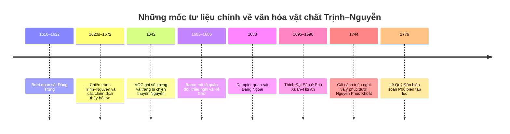

# Văn hóa vật chất quân sự và dân sự ở Đàng Trong và Đàng Ngoài thời Trịnh–Nguyễn, khoảng thế kỷ XVI–XVIII

## Tóm tắt điều hành

Các nguồn đương thời cho thấy không nên hình dung quân đội Trịnh–Nguyễn như hai hệ thống có “quân phục” đồng nhất theo nghĩa quân đội thế kỷ XIX. Bằng chứng tốt nhất cho thế kỷ XVII cho thấy binh sĩ mang trang phục địa phương tương đối gần dân phục, còn sự phân biệt về địa vị thể hiện ở **chất liệu, số lớp áo, độ sang của vải, đồ trang sức, trang bị ngựa, cờ lọng và vũ khí** hơn là bằng một bộ quân phục chuẩn hóa toàn quân. Ở Đàng Ngoài năm 1688, William Dampier ghi rõ người nghèo và binh lính chủ yếu mặc **vải bông nhuộm màu nâu sẫm**, trong khi Samuel Baron cho thấy bộ binh luyện súng dài, kiếm-khiên và cung; kỵ binh luyện thương. Trái lại, Christoforo Borri ở Đàng Trong khoảng 1618–1622 nhấn mạnh mức độ phổ biến đáng kinh ngạc của **lụa, áo nhiều lớp và màu sắc đa dạng**, nhưng mô tả này có thể chứa yếu tố cường điệu văn chương về sự phồn thịnh của xứ sở. citeturn18search26turn3view0turn4view0turn26search3

iturn10image0turn10image1turn10image2turn10image6

Bốn hình trên minh họa bốn loại chứng cứ cần đọc song song: cảnh thao diễn quân sự của Samuel Baron ở Đàng Ngoài; phủ chúa Trịnh trong bộ tranh Baron; chi tiết tranh cuộn Nhật Bản về Đàng Trong; và một tranh cuộn tàu Châu ấn Nhật Bản trong sưu tập Bảo tàng Quốc gia Kyushu. Hai hình Baron thuộc hệ minh họa cho *A Description of the Kingdom of Tonqueen* khoảng 1684–1686; các tranh cuộn Nhật Bản là bằng chứng đặc biệt quan trọng về Hội An–Thanh Chiêm–Thuận Quảng, nhưng không phải bản vẽ kỹ thuật theo nghĩa hiện đại. citeturn2view0turn9view1turn18search5

Sự khác nhau rõ nhất về **cấu trúc quân sự** nằm ở môi trường hoạt động. Baron nhận xét Đàng Ngoài dựa vào bộ binh nhiều hơn kỵ binh hay tượng binh vì đồng bằng thấp, nhiều sông và vùng lầy; tuy vậy Trịnh vẫn duy trì ngựa chiến, voi chiến và hạm đội rất lớn. Ở Đàng Trong, địa lý dải duyên hải hẹp, bị núi chia cắt khiến thuyền trở thành phương tiện nối các vùng, vận chuyển thuế, lương và quân; Charles Wheeler, dựa nhiều vào *Phủ biên tạp lục*, cho thấy nhà Nguyễn duy trì các đội thuyền, trạm, kho và xưởng nhà nước, đồng thời dựa trên cả một nền kinh tế đóng thuyền tư nhân. citeturn3view0turn19view2

Về hỏa lực, cả hai bên đều tiếp nhận, mua bán và nội địa hóa công nghệ súng phương Tây. Đàng Ngoài nổi bật trong nguồn Baron bởi khả năng bắn súng dài nhanh và chính xác; người Anh và Hà Lan bán súng, đạn, thuốc súng và diêm tiêu, còn năm 1678 người Anh được yêu cầu tìm thợ súng có thể truyền kỹ thuật đúc. Đàng Trong được Borri và các nguồn VOC mô tả đặc biệt mạnh về pháo và pháo hạm; người Nguyễn vừa tận dụng súng phương Tây, vừa phát triển năng lực đúc trong nước. Tuy nhiên niên đại chính xác của vai trò người Bồ João da Cruz đối với Phường Đúc vẫn là vấn đề tranh luận sử học, không nên kể như một câu chuyện đã hoàn toàn được giải quyết. citeturn2view2turn24search15

Vật chứng hiện còn thiên lệch về Đàng Ngoài. Bộ sưu tập Giảng Võ ở Bảo tàng Hà Nội gồm vũ khí lạnh và hỏa khí niên đại rộng từ thế kỷ XV đến XVIII, trong khi Hoàng thành Thăng Long hiện công bố mô hình 3D một khẩu **súng thần công Lê Trung Hưng thế kỷ XVII**. Đây là những cứ liệu an toàn hơn nhiều so với các hình phục dựng hiện đại về giáp trụ hoặc súng. citeturn9view3turn9view2turn7search2

Đối với **giáp, mũ sắt và huy hiệu quân phục**, bằng chứng thế kỷ XVII–XVIII hiện yếu hơn nhiều so với bằng chứng về vải vóc và vũ khí. Tranh Baron không cho thấy bộ binh thông thường mặc giáp tấm đồng nhất; tranh Nhật Bản về Đàng Trong cũng chủ yếu thể hiện người mang áo dài/áo khoác, vũ khí cán dài, voi và pháo. Vì vậy các phục dựng với toàn bộ lính Trịnh hoặc Nguyễn mặc giáp phiến đồng nhất, đội một kiểu mũ sắt chuẩn và mang màu quân phục cố định cần được coi là **giả thuyết nghệ thuật**, trừ khi có chứng cứ cụ thể cho đơn vị hoặc nghi lễ đó. citeturn4view0turn9view1turn9view3

Cuối cùng, năm 1744 là một mốc văn hóa vật chất quan trọng ở Đàng Trong. *Phủ biên tạp lục* được các nghiên cứu hiện nay dùng làm nguồn chủ yếu về việc Nguyễn Phúc Khoát thay đổi chế độ triều nghi và y phục nhằm định hình một trật tự chính trị riêng. Tuy nhiên cách kể phổ biến rằng năm 1744 một sắc lệnh duy nhất đã “phát minh ra áo dài” là giản lược quá mức; văn bản gốc cho phép nói chắc hơn về **cải cách quy chế y phục và phong tục cung đình–xã hội**, chứ không cho phép đồng nhất ngay với mọi dạng áo dài về sau. citeturn18search19turn18search27

## Nguồn tư liệu, niên đại và cách đọc chứng cứ

Trong báo cáo này, “Đàng Trong/Cochinchina” chỉ lãnh thổ do các chúa Nguyễn kiểm soát trong cách dùng của người châu Âu thế kỷ XVII, không đồng nghĩa hoàn toàn với “Cochinchina/Nam Kỳ” thời thuộc Pháp. “Đàng Ngoài/Tonkin” chỉ không gian Lê–Trịnh phía bắc. Chính các biên tập viên Olga Dror và Keith W. Taylor lưu ý rằng Borri và Baron quan sát hai xã hội khác nhau, ở những thời điểm khác nhau và với vị thế cá nhân rất khác nhau. citeturn2view0turn18search20

**Christoforo Borri** ở Đàng Trong khoảng 1618–1622; bản tường thuật của ông trở thành một trong những mô tả châu Âu sớm nhất về xứ Nguyễn. **Samuel Baron**, sinh tại Hà Nội, con của một người cha Hà Lan và mẹ Việt, hoạt động thương mại tại Đàng Ngoài trong thập niên 1670–1680; do đó ông không đơn giản là “du khách phương Tây”, nhưng nghiên cứu của Anna Winterbottom cũng cảnh báo rằng tác phẩm của ông sử dụng những quy ước văn chương du ký và được viết trong bối cảnh Baron tự kiến tạo vị thế trước giới bảo trợ châu Âu. citeturn2view0turn18search9turn25search4

**William Dampier** tới Đàng Ngoài năm 1688. Tường thuật của ông đặc biệt có giá trị về quần áo binh sĩ, trang bị bộ binh và thuyền của chính quyền Trịnh. Bảo tàng Lịch sử Quốc gia Việt Nam xác nhận chuyến đi năm 1688 và việc tác phẩm dành một chương cho chính quyền, quân đội và quan lại Đàng Ngoài. citeturn18search2turn22search2

**Thích Đại Sán/Thạch Liêm** ở Thuận Quảng năm 1695–1696 theo lời mời của Nguyễn Phúc Chu; *Hải ngoại kỷ sự* là nguồn gần đương thời quan trọng về Phú Xuân, phủ chúa, quân lính và xã hội cuối thế kỷ XVII. **Lê Quý Đôn**, với *Phủ biên tạp lục* năm 1776, đến muộn hơn một thế hệ so với đỉnh cao chiến tranh Trịnh–Nguyễn nhưng đặc biệt quý về vật liệu, nghề đóng tàu, sản vật, tổ chức kinh tế và ký ức về chế độ chúa Nguyễn vừa bị lật đổ. citeturn25search2turn25search26turn19view2

Các mốc trên phản ánh cả biến đổi lịch sử lẫn biến đổi của “ống kính” quan sát. Hạm đội trong cao điểm chiến tranh 1640–1670 không nhất thiết giống lực lượng Dampier nhìn thấy năm 1688, sau khi chiến tranh Trịnh–Nguyễn đã ngừng; tương tự, nghề đóng thuyền mà Lê Quý Đôn thấy năm 1776 có thể bảo tồn truyền thống Nguyễn trước đó nhưng không thể tự động chiếu ngược từng chi tiết kỹ thuật về năm 1620. citeturn2view2turn19view2

Hai nhóm hình ảnh đặc biệt quan trọng. Thứ nhất là hệ tranh của Baron, trong đó có **“Their Martial Exercises”**, **“The Court of the Choua or General of Tonqueen”** và toàn cảnh **Cha-Cho/Kẻ Chợ**; bản Cornell xác nhận các hình được sao lại từ sưu tập bản thảo quý hiếm của Cornell. Thứ hai là hai tranh cuộn Nhật Bản *Chaya Shinroku Kochi toko zukan* và *Shuin-sen Kochi toko zukan*: Bảo tàng Lịch sử Quốc gia cho biết tranh Chaya có niên đại thế kỷ XVII, còn tranh Shuinsen vào cuối thế kỷ XVII–đầu XVIII, thể hiện thương cảng, dinh/phủ, hàng pháo, quân lính và voi ở Thuận Quảng. citeturn2view0turn9view1

Độ chắc chắn của các mô tả dưới đây vì thế được hiểu theo ba mức: **cao** khi có văn bản gần đương thời cộng với hiện vật/hình ảnh; **trung bình** khi dựa trên một nguồn mô tả hoặc tranh quy ước; **thấp** khi phải phục dựng từ thuật ngữ muộn hơn hoặc suy luận từ truyền thống kỹ thuật.

## Quân đội: trang phục, vũ khí và các binh chủng

**Bộ binh, binh lính — infantry/foot soldiers.** Ở Đàng Ngoài cuối thế kỷ XVII, bằng chứng trực tiếp đặc biệt rõ. Dampier nói trang phục người Tonkin làm bằng lụa hoặc bông, nhưng **người nghèo và binh lính chủ yếu dùng vải bông nhuộm màu nâu sẫm**. Ông cũng mô tả lực lượng thường trực khoảng 70–80 nghìn người theo lời đương thời, phần lớn là bộ binh, mang kiếm hoặc một loại đoản đao mà bản tiếng Anh ghi là “Curtans”, cùng súng tay dài khoảng ba feet rưỡi. Con số quân số là lời ước lượng, còn mô tả về vải và vũ khí có giá trị trực tiếp hơn. citeturn18search26turn20search0

Tranh thao diễn của Baron bổ sung một bộ trang bị gồm bốn nhóm: **thương khi cưỡi ngựa; súng dài; kiếm và khiên; cung tên**. Baron đánh giá xạ thủ Đàng Ngoài bắn súng rất thành thạo và nhanh, trong khi cung vẫn thông dụng. Đáng chú ý, ông nói loại “firelock” chưa được dùng; vì vậy không nên mặc nhiên vẽ mọi súng dài Đàng Ngoài năm 1680 thành súng đá lửa kiểu châu Âu. Cơ cấu điểm hỏa của từng khẩu phải xác định từ hiện vật cụ thể. citeturn3view0turn4view0

Bằng chứng khảo cổ–bảo tàng tương thích với một kho vũ khí hỗn hợp như vậy. Bảo tàng Hà Nội cho biết sưu tập Giảng Võ gồm hơn một trăm hiện vật và cả **vũ khí lạnh lẫn hỏa khí**, có niên đại rộng từ thế kỷ XV đến XVIII. Điều này củng cố hình ảnh quân Lê–Trịnh không phải quân đội “chỉ dùng súng”, mà vẫn phối hợp đao, kiếm, giáo/thương, cung và hỏa khí. citeturn9view3turn6search4

Ở Đàng Trong, dữ liệu về **quân phục riêng của bộ binh** yếu hơn dữ liệu về dân phục, hải quân và pháo. Borri cho biết nam giới Đàng Trong nói chung mặc nhiều lớp áo lụa rộng, nhiều màu; tranh cuộn Nhật Bản lại vẽ các nhóm người mang vũ khí cán dài quanh khu dinh/phủ trong những áo choàng hoặc áo dài màu khác nhau. Tuy nhiên bảng màu trong tranh Edo không thể được đọc như bảng màu quân phục nhà Nguyễn: màu xanh, xám, vàng hay đỏ trong tranh là bằng chứng thị giác về sự đa sắc, không phải bằng chứng một trung đoàn cụ thể mang “màu hiệu” cố định. citeturn26search3turn9view1

Không có bằng chứng đủ mạnh để khẳng định bộ binh phổ thông của hai bên thường xuyên mặc **áo giáp kim loại nặng**. Cả tranh Baron về thao diễn và tranh Nhật về Thuận Quảng đều nhấn mạnh quần áo mềm và vũ khí hơn là giáp tấm. Giáp có thể tồn tại ở cá nhân hoặc đơn vị nhất định, nhưng hiện không có cơ sở để biến nó thành trang bị chuẩn cho mọi lính. Độ chắc: cao về vũ khí; trung bình về dáng áo; thấp về mọi phục dựng “quân phục chuẩn hóa”. citeturn4view0turn9view1

**Kỵ binh — cavalry.** Đàng Ngoài có bằng chứng tốt hơn hẳn. Baron mô tả ngựa bản địa nhìn chung nhỏ nhưng lanh lẹ; cảnh thao diễn ghi rõ bài **thương trên lưng ngựa**. Trong một lễ tiếp sứ Thanh năm 1683, Baron cho biết kỵ binh và voi được trang bị đồ dùng tốt nhất, trong khi binh lính được mặc sang bằng hàng dệt Anh và Hà Lan. Đây là trang bị nghi lễ của đội quân được chọn để phô diễn quyền lực, không phải bằng chứng rằng mọi kỵ binh Trịnh quanh năm mặc vải nhập khẩu. citeturn4view0turn4view3turn5view5

Các ước lượng đương thời về số ngựa khác nhau rất mạnh: bản tổng hợp nguồn phương Tây dẫn Baron khoảng 8.000–10.000 ngựa chiến, trong khi de Marini đưa con số khác. Quan trọng hơn quân số là nhận xét chiến thuật của Baron: trong địa hình đồng bằng thấp, lầy và đầy sông ngòi, chính quyền Trịnh tin cậy **bộ binh** hơn kỵ binh và tượng binh. Vì vậy kỵ binh ở Đàng Ngoài có chức năng thao diễn, hộ vệ, trinh sát và chiến đấu trên địa hình thích hợp nhưng không giữ vai trò quyết định tương đương kỵ binh trong các đế quốc thảo nguyên. citeturn2view2turn3view0

Đối với Đàng Trong, nguồn thế kỷ XVII được khảo sát ở đây nhấn mạnh **voi, thuyền và pháo** nhiều hơn ngựa. Không nên từ đó suy ra người Nguyễn “không có kỵ binh”; kết luận an toàn hơn là kỵ binh Nguyễn kém nổi bật trong tập hợp nguồn châu Âu và Nhật Bản hiện có. Độ chắc của mọi phục dựng áo giáp, yên ngựa hay màu cờ kỵ binh Nguyễn cụ thể hiện thấp.

**Lính hỏa mai, điểu thương thủ — musketeer/arquebusier.** Đây là thuật ngữ cần đặc biệt thận trọng. Bảo tàng Lịch sử Quốc gia dùng tên **điểu thương** cho một dạng súng hỏa mai trở nên nổi bật từ cuối thế kỷ XVII. Trong nghiên cứu và phục dựng hiện nay, “lính hỏa mai” thường được dùng rộng cho người lính mang súng dài nạp miệng; nhưng không nên đồng nhất mọi “hỏa mai” với **flintlock**. Chính Baron nói cơ cấu firelock không thông dụng ở Đàng Ngoài cuối thế kỷ XVII. citeturn23search3turn4view0

Về chức năng, xạ thủ Trịnh có vẻ là lực lượng được huấn luyện nghiêm túc: Baron nhấn mạnh cả độ chính xác lẫn tốc độ thao tác. Tuy nhiên cụm “elite guards/linh hỏa mai” của nghiên cứu hiện đại nên được tách thành hai vấn đề: **xạ thủ súng dài** không mặc nhiên là cấm vệ, và **cấm vệ** không mặc nhiên đều là xạ thủ. Chỉ trong triều nghi hoặc đội quân tuyển chọn chúng ta mới có chứng cứ về trang phục đặc biệt sang trọng như hàng Anh–Hà Lan năm 1683. citeturn3view0turn4view3

Ở Đàng Trong, các nguồn VOC và truyền giáo xác nhận súng tay hiện diện rộng cùng pháo trên chiến thuyền. Bản tổng hợp tư liệu phương Tây dẫn báo cáo VOC năm 1642 nói các chiến thuyền Nguyễn có pháo cùng giáo và các loại vũ khí cán dài; Borri lại coi năng lực sử dụng pháo và hỏa khí là một ưu thế lớn của chính quyền Nguyễn. Tuy nhiên chưa có đủ hiện vật súng cá nhân có xuất xứ khảo cổ chắc chắn từ một đơn vị Nguyễn thế kỷ XVII để phục dựng chi tiết báng, khóa súng và dây đeo cho toàn quân. citeturn2view2

**Pháo binh — artillery/gunners.** Đàng Ngoài có một lợi thế nghiên cứu hiếm có: khẩu **súng thần công Lê Trung Hưng thế kỷ XVII** tại Hoàng thành Thăng Long đã được công bố dưới dạng hiện vật 3D. Mô tả chính thức chia thân súng thành phần miệng, thân/nòng, buồng thuốc và đuôi; hiện vật không có kiểu trunnion ngang như nhiều đại bác châu Âu đời sau. Bảo tàng Lịch sử Quốc gia cũng cho biết nhiều súng cổ Việt Nam sử dụng lỗ điểm hỏa phía sau, viên đạn đá hoặc kim loại hình cầu và cơ cấu gá đỡ qua phần đuôi hơn là hệ trục ngang hiện đại. Các đặc trưng tổng quát này không nên gán máy móc cho mọi khẩu pháo thế kỷ XVII, nhưng chúng cho thấy truyền thống chế tạo nội địa có hình thái riêng. citeturn7search2turn9view2turn6search1

Đàng Ngoài đồng thời tiếp tục mua công nghệ và vật tư nước ngoài. Hồ sơ phương Tây được tổng hợp trong nghiên cứu về chiến tranh Trịnh–Nguyễn ghi việc người Hà Lan hướng dẫn một võ quan Trịnh làm lựu đạn năm 1658, người Anh bán pháo, thuốc súng, đạn và diêm tiêu, và năm 1678 có yêu cầu tìm người thợ biết kỹ thuật đúc súng phương Tây. Điều này gợi một hệ thống **lai ghép** giữa hỏa khí nội địa, hàng nhập và chuyển giao kỹ thuật hơn là sự thay thế hoàn toàn một truyền thống bởi một truyền thống khác. citeturn2view2

Đàng Trong nổi bật hơn nữa trong lời kể người châu Âu. Borri cho rằng các chúa Nguyễn thu được pháo từ tàu Bồ Đào Nha và Hà Lan bị đắm và trở nên rất thiện nghệ trong sử dụng pháo; những nguồn sau đó ghi pháo trên hạm đội Nguyễn với số lượng lớn. Vấn đề João da Cruz và xưởng đúc Phú Xuân lại phức tạp: một truyền thống nghiên cứu đặt hoạt động của ông rất sớm, trong khi Pierre-Yves Manguin từng nghi ngờ niên đại ấy và đặt sự xuất hiện của da Cruz muộn hơn; việc nhà Nguyễn còn gửi đồng sang Macau để đúc pháo năm 1651 là một phần lý do của tranh luận. Do vậy cụm “Phường Đúc do người Bồ lập năm 1615” không nên dùng như một dữ kiện tuyệt đối chắc chắn. citeturn2view2turn24search15

Về **trang phục pháo thủ**, cả hai bên thiếu mô tả chuyên biệt. Không có chứng cứ đủ để gán cho pháo thủ một màu áo riêng. Hình ảnh tốt hơn nằm ở chính khẩu pháo, vị trí pháo trên thuyền và dãy pháo bảo vệ phủ/dinh.

**Tượng binh — elephant corps**, một đơn vị liên quan cần bổ sung. Baron ghi voi Đàng Ngoài được luyện để quen tiếng nổ và pháo hoa; các tường thuật chiến dịch còn đưa ra những đoàn voi lớn đi cùng quân Trịnh. Tranh Nhật Bản về Đàng Trong lại thể hiện voi với quản tượng ngay cạnh trung tâm hành chính và binh lính. Trong cuộc tiếp sứ Thanh năm 1683, voi Trịnh cũng được trang bị đồ nghi trượng tốt nhất. Nhưng những con số 300, 400, 500 hay 600 voi từ các tác giả khác nhau không nên cộng hoặc coi như biên chế chính thức; chúng phản ánh các thời điểm và cách đếm khác nhau. citeturn4view0turn4view3turn9view1turn2view2

## Dân phục, nông dân và nhà ở

**Nông dân — peasants.** Đối lập nổi bật nhất trong nguồn là giữa lời Borri về Đàng Trong đầu thế kỷ XVII và Dampier về Đàng Ngoài cuối thế kỷ ấy. Borri mô tả việc mặc lụa rất phổ biến qua nhiều tầng lớp. Theo bản tóm thuật sát nguồn của Donald Lach, phụ nữ mặc nhiều lớp váy/quần áo bên dưới với màu khác nhau, thân trên có áo hoặc yếm hoa/kẻ và một lớp ngoài mỏng; phụ nữ địa vị cao mang loại nón rộng có sợi lụa và vàng. Nam giới quấn vải ở thân dưới rồi mặc khoảng năm hoặc sáu áo lụa màu, tay rộng, xẻ phía dưới để lộ các màu khác nhau, tóc để dài và đội nón rộng. citeturn26search1turn26search3turn18search20

Điều đáng chú ý là Borri không chỉ nói về quý tộc: truyền thống văn bản của ông nhấn mạnh sự dồi dào của lụa đến mức người lao động và thợ thủ công cũng có thể mặc lụa. Đây là một quan sát cực kỳ hấp dẫn nhưng phải xử lý như một **tuyên bố của Borri**, không như thống kê tiêu dùng hộ gia đình. Văn phong du ký đầu cận đại thường dùng sự dư dật khác thường để nhấn mạnh tính kỳ lạ và phồn thịnh của nơi được mô tả. citeturn2view0turn26search3

Dampier lại đưa ra hình ảnh Đàng Ngoài năm 1688 giản dị hơn nhiều: quần áo có cả lụa và bông, nhưng **người nghèo cùng binh lính phần lớn dùng bông nhuộm nâu sẫm**. Đây là bằng chứng trực tiếp tốt nhất cho phục trang phổ thông Bắc Bộ cuối thế kỷ XVII. Sự khác biệt với Borri không nhất thiết chứng minh một đường biên văn hóa tuyệt đối “Nam mặc lụa, Bắc mặc bông”: hai tác giả cách nhau khoảng bảy thập kỷ, quan sát các tầng lớp và bối cảnh kinh tế khác nhau, và viết với mục đích khác nhau. citeturn18search26turn2view0

Do đó, với phục dựng nông dân, phương án có độ tin cậy cao là: **Đàng Ngoài cuối XVII** ưu tiên áo/quần vải bông tông nâu sẫm đối với tầng lớp nghèo; **Đàng Trong đầu XVII** cho phép phổ màu và lụa rộng hơn đáng kể theo Borri, nhưng không nên mặc mọi nông dân bằng sáu lớp lụa sang trong cảnh lao động thường ngày chỉ từ một đoạn du ký. citeturn18search26turn26search3

**Biến đổi y phục Đàng Trong thế kỷ XVIII.** Tư liệu *Phủ biên tạp lục* về thời Nguyễn Phúc Khoát là mốc quan trọng trong quá trình Đàng Trong chủ động xác lập quy chế văn hóa và triều nghi khác với Đàng Ngoài. Bản Hán văn hiện được dẫn từ bản Thư viện Quốc gia Việt Nam ký hiệu R.1605, tờ 33a–b. Cần phân biệt ba tầng: văn bản thế kỷ XVIII về thay đổi y phục; những diễn giải thế kỷ XIX về quá trình phát triển trang phục; và câu chuyện đại chúng hiện nay về “nguồn gốc áo dài”. Chúng không hoàn toàn đồng nhất. citeturn18search19turn18search27

**Nhà ở — houses/residences.** Đây là một trong những chủ đề có khoảng trống nguồn lớn nhất. Tranh toàn cảnh Kẻ Chợ của Baron cho thấy một đô thị bờ sông dày đặc thuyền bè, các cụm kiến trúc mái dốc, đền miếu, nhà và khu quyền lực; trong khi tranh cuộn Nhật về Thuận Quảng đặt dinh/phủ giữa đồng ruộng, làng và mạng lưới sông. Hai nhóm tranh cho phép phục dựng **mặt bằng cảnh quan** tốt hơn cấu tạo một ngôi nhà dân cụ thể. citeturn25search0turn25search8turn9view1

Với nhà tầng lớp trên, tranh thể hiện rõ cấu trúc nhiều gian, sân và mái lớn hơn nhà dân; với nhà phổ thông, vật liệu nhẹ như gỗ, tre và tranh rất phù hợp với truyền thống kiến trúc địa phương, nhưng để khẳng định tỷ lệ tre/gỗ, loại ngói hoặc kỹ thuật mộng của một căn nhà năm 1650 cần bằng chứng khảo cổ riêng. Không nên lấy một nhà dân thế kỷ XIX–XX còn tồn tại rồi coi đó là bản sao nguyên vẹn của nhà thế kỷ XVII.

Sự khác biệt chức năng có thể nói chắc hơn: Kẻ Chợ là trung tâm chính trị–thương mại nội địa lớn gắn với hệ thống sông Hồng, còn nhiều trung tâm Nguyễn được tổ chức theo chuỗi **dinh–cảng–sông–biển** dọc dải duyên hải. Wheeler cho thấy ở miền Trung, đường thủy thường đóng vai trò nối các lưu vực bị núi ngăn cách và nhiều trung tâm hành chính nằm gần đầu mối sông, chợ và dinh quân sự. citeturn19view2

**Thợ thủ công, thợ đóng thuyền, thương nhân và dân cảng** cũng cần coi là một loại “đơn vị vật chất” riêng. Đàng Trong có một môi trường thủy–thương mại rất đậm nét: thuyền liên kết người miền núi cung cấp gỗ, mây, nhựa, kim loại với thợ thủ công, nông dân, ngư dân và thương cảng. Đây là lý do vật liệu đóng thuyền và đóng công trình không thể tách khỏi mạng trao đổi giữa núi, đồng bằng và biển. citeturn19view2

## Thành lũy, trại, phủ chúa và cơ sở hậu cần

**Thành lũy — fortifications/ramparts.** Hệ phòng thủ Nguyễn ở Quảng Bình là một trong những khác biệt vật chất quan trọng nhất giữa hai miền trong thời chiến. Phần giới thiệu của Dror–Taylor ghi nhận khu biên giới được quân sự hóa và các lũy Nguyễn chạy trong vùng Đồng Hới từ phía biển về hướng núi, tạo thành vật cản bảo vệ cửa ngõ Đàng Trong. Đây không phải thành đá kiểu Vauban hoàn chỉnh mà là một hệ phòng tuyến thích nghi với địa hình hẹp giữa núi và biển. citeturn2view0

Nguồn hình ảnh Nhật Bản bổ sung một cấp phòng thủ khác: **hàng rào/palisade** bao quanh trung tâm quyền lực Nguyễn và các hàng pháo bố trí gần dinh. Bảo tàng Lịch sử Quốc gia cho biết cả tranh Chaya và Shuinsen đều thể hiện dinh/phủ với rào bao, súng và quân lính; khi đối chiếu với *Hải ngoại kỷ sự* năm 1695 và *Phủ biên tạp lục*, hình ảnh hàng rào tre gai cùng pháo quanh khu Phú Xuân trở nên đặc biệt đáng chú ý. citeturn9view1

Tuy nhiên, kích thước tiết diện chính xác của các lũy thế kỷ XVII, số lớp tre, tỷ lệ đất–gỗ và vị trí từng ụ pháo đã bị ảnh hưởng mạnh bởi sửa chữa, chiến tranh và tái thiết về sau. Vì vậy các sơ đồ phục dựng hiện đại của “Lũy Thầy” cần phân biệt rõ phần dựa vào sử liệu với phần dựa vào di tích muộn hơn.

Ở Đàng Ngoài, chức năng phòng thủ lại phân tán giữa thành Thăng Long, khu phủ Trịnh, trấn, đồn và đặc biệt các doanh quân phía nam trong chiến tranh với Nguyễn. Baron/Dampier cung cấp nhiều thông tin về quân đội hơn về mặt cắt công sự. Bằng chứng hiện vật pháo tại Hoàng thành và sưu tập Giảng Võ chứng minh khu vực kinh đô là một trung tâm quân sự–kỹ thuật lớn, nhưng không đủ để vẽ lại mọi lũy Trịnh thế kỷ XVII. citeturn9view2turn9view3

**Trại lính — military camp/barracks.** Ở Đàng Trong, mô tả Phú Xuân cuối thế kỷ XVII là nguồn rất quý: khu quyền lực có những **trại quân mái tranh**, hàng pháo và hàng rào tre gai. Nó cho thấy một nguyên tắc quan trọng: kiến trúc quân sự không nhất thiết “đồ sộ” theo nghĩa xây gạch đá; một tổ hợp bằng gỗ, tre, tranh, đất và pháo vẫn có thể là cơ sở quân sự trung tâm của nhà nước. citeturn9view1

Trại Đàng Ngoài khó phục dựng chi tiết hơn. Dampier ước lượng phần đáng kể quân Trịnh ở kinh đô và phần còn lại trên tuyến phía nam; Baron cũng mô tả việc quân bị điều động, thay chỉ huy và duy trì trong lao động hoặc thao luyện. Điều này gợi các doanh quân không chỉ là chỗ ngủ mà còn là nơi tổ chức lao dịch, thao diễn và hậu cần. Tuy nhiên chưa có bản vẽ doanh trại đủ chi tiết để quy định một mô hình kiến trúc chuẩn cho toàn Đàng Ngoài. citeturn3view0turn2view2

**Trại kỵ binh và chuồng ngựa — cavalry stables/camps.** Đây là hạng mục có độ chắc thấp nhất. Baron chứng minh chắc chắn có kỵ binh, thao diễn thương và một lực lượng ngựa chiến đáng kể; toàn cảnh Kẻ Chợ cho thấy một quần thể quân sự–cung đình rộng lớn. Nhưng các nguồn được khảo sát không cung cấp mặt bằng chuồng ngựa, vật liệu máng ăn, kích thước ô chuồng hay kiến trúc doanh kỵ binh đủ chắc để phục dựng. citeturn4view0turn25search0

Vì vậy một phục dựng khoa học nên thể hiện **khu chuồng bằng cấu kiện gỗ/tre và sân buộc ngựa** như giả thuyết chức năng, chứ không ghi đó là kiến trúc xác nhận khảo cổ. Đối với Đàng Trong, bằng chứng còn kém hơn nữa; tuyệt đối không nên dựng cả một “trại kỵ binh Nguyễn tiêu chuẩn” dựa trên mẫu trại Bắc Bộ hoặc Trung Quốc mà không đánh dấu là suy đoán.

**Phủ chúa — lord’s palace/administrative residence.** Đàng Ngoài có hình Baron “Court of the Choua or General of Tonqueen”, một nguồn thị giác hiếm về phủ Trịnh: quần thể nhiều lớp kiến trúc, sân, nhà chính và không gian nghi lễ. Quan trọng về mặt chính trị là đây là **phủ của chúa Trịnh**, tồn tại song song với cung đình vua Lê; gọi nó đơn giản là “hoàng cung Tonkin” sẽ xóa đi cấu trúc lưỡng đầu Lê–Trịnh. citeturn18search5turn2view0

Văn hóa vật chất phủ Trịnh có tính phô diễn rất mạnh. Trong tiếp sứ Thanh năm 1683, binh sĩ tuyển chọn mặc hàng dệt Anh–Hà Lan, voi và ngựa mang đồ trang sức tốt, còn thuyền của nhà chúa được mạ/trang trí vàng. Đây là một trong những bằng chứng tốt nhất cho sự khác biệt giữa **quân phục thường ngày** và **trang phục–trang bị nghi lễ nhà nước**. citeturn4view3turn5view5

Đàng Trong lại có hai tranh cuộn Nhật đặc biệt giá trị. Tranh Chaya thể hiện trung tâm Thanh Chiêm với rào, pháo, sông, ruộng và voi; tranh Shuinsen cũng cho thấy một phủ có hàng pháo, quân và voi. Tác giả bài nghiên cứu của Bảo tàng Lịch sử Quốc gia đề xuất nhận diện phần cuối tranh Shuinsen là **Phú Xuân**, nhưng chính nhận diện này nên được ghi là một cách diễn giải chứ chưa phải đồng thuận tuyệt đối. citeturn9view1

Đối chiếu với *Hải ngoại kỷ sự* 1695 tăng độ tin cậy cho hình ảnh chung về Phú Xuân: trung tâm nhà chúa nằm ven sông, xung quanh có trại quân, rào tre gai và nhiều pháo đồng. Điều này cho thấy phủ Nguyễn vừa là **residence**, vừa là **administrative compound**, vừa là **fortified military complex**. citeturn9view1turn25search2

**Xưởng đóng tàu — shipyard/boatbuilding workshop.** Đàng Trong có dữ liệu kỹ thuật đặc biệt phong phú vào cuối thời chúa Nguyễn. Wheeler, dựa trên Lê Quý Đôn, cho biết vùng kinh đô có nhiều cơ sở đóng thuyền nhỏ phục vụ đường sông, đường biển và phà; đồng thời nhà nước Nguyễn vận hành các xưởng để đóng và sửa hạm đội. Thuyền còn là hàng hóa, được sản xuất với số lượng đáng kể cho thương mại ven biển. citeturn19view2

Chuỗi vật liệu rất cụ thể. *Phủ biên tạp lục* ghi hoặc cho phép Wheeler liên hệ nhiều loại **gỗ sao, kiến kiến, lim, táu, dầu, cụ/gụ**, mây và các loại nhựa với đóng thuyền. Gỗ được lựa theo đặc tính cơ học: loại chịu uốn cho mái chèo, bánh lái và các chi tiết chịu tải; gỗ thẳng nhẹ cho cột buồm và sào; gỗ bền, chống mục cho thân. Đáng chú ý, Lê Quý Đôn nói **kiến kiến** từng được dùng rộng cho thuyền, nhưng **gỗ sao** thích hợp hơn cho một số tàu biển chịu gió mạnh. citeturn19view2

Kỹ thuật bảo dưỡng bao gồm **xảm kín khe**, dùng nhựa/dầu phủ thân và ở một số kiểu thuyền dùng mây trong liên kết. Ở Minh Linh, Wheeler dẫn Lê Quý Đôn về việc dùng mạt hoặc phoi một loại gỗ dầu để xảm thuyền; nhựa và sơn cũng là sản vật được tổ chức thu gom. Đây là một hệ kỹ thuật đóng thuyền dựa rất chặt vào tài nguyên rừng miền Trung. citeturn19view2

Đàng Ngoài chắc chắn có năng lực đóng và duy trì hạm đội lớn, nhưng tập hợp nguồn ở đây không cho một bảng vật liệu–kỹ thuật tương đương *Phủ biên tạp lục*. Vì vậy chênh lệch thông tin không nên nhầm với chênh lệch kỹ thuật thực tế: ta **biết chi tiết về xưởng Nguyễn hơn**, chứ chưa thể chứng minh thợ Trịnh kém tinh vi hơn.

**Kho, quân khí xưởng và trạm thuyền** là một hạng mục liên quan. Wheeler cho thấy nhà Nguyễn đặt các đội thuyền ở trạm và kho dọc sông/bờ biển, dùng chúng vừa để cưỡng chế hành chính vừa chở thóc thuế về kho nhà nước. Đây là “hậu cần quân sự” theo nghĩa rộng, nơi kho lương, thuyền vận tải và quyền lực hành chính là một hệ thống duy nhất. citeturn19view2

## Thuyền vận tải, chiến thuyền và chiến tranh thủy bộ

**Thuyền vận tải — transport craft/cargo boat.** Đối với Đàng Trong, thuyền không chỉ là phương tiện phụ trợ mà là xương sống của không gian chính trị. Thích Đại Sán cuối thế kỷ XVII nhận xét các phủ dọc duyên hải liên hệ với nhau chủ yếu qua biển; Wheeler cho thấy nhà Nguyễn vận chuyển thóc thuế bằng đội thuyền nhà nước, huy động cả thuyền buôn ven biển khi cần và dùng vận tải biển để phân phối gạo giữa các vùng. citeturn19view2

Những thuyền này có thể trải từ thuyền sông nhỏ, phà, thuyền vận chuyển nội vùng tới **coaster** đi dọc bờ biển. Do nguồn gọi nhiều loại phương tiện bằng thuật ngữ chung, việc vẽ một “thuyền vận tải Nguyễn tiêu chuẩn” là sai phương pháp. Cấu tạo phải tùy chức năng: đáy và mớn nước cho sông khác thuyền vượt cửa biển; vật liệu thân và cột buồm cũng được Lê Quý Đôn phân biệt theo điều kiện sử dụng. citeturn19view2

Đàng Ngoài có một mạng thuyền vận tải khổng lồ trong chiến tranh. Bản tổng hợp các nguồn phương Tây dẫn Alexandre de Rhodes mô tả một chiến dịch Trịnh với hơn 200 chiến thuyền phía trước và hơn 500 thuyền chở lương theo sau. Baron lại ước tính khoảng 220 galley chiến và 500 galley vận tải. Các số này không phải số liệu kiểm kê có thể cộng với nhau; chúng cho thấy một nguyên tắc đáng tin hơn: **hạm đội chiến đấu chỉ hoạt động được nhờ một đoàn vận tải lớn ít nhất cùng bậc quy mô**. citeturn2view2

**Chiến thuyền Đàng Ngoài — Tonkinese war galleys.** Các nguồn thống nhất ở việc sử dụng **galley chèo**, phù hợp sông, cửa biển và vùng nước ven bờ. Baron đưa số lượng lớn; de Rhodes mô tả đoàn chiến thuyền có pháo và quân hỏa mai; Dampier sau đó nói lực lượng hải quân gồm loại galley đáy phẳng và đánh giá chúng có phần thiên về phô trương nhà nước hoặc chở quân hơn là chiến đấu biển xa. citeturn2view2turn22search2

Mâu thuẫn này có thể giải thích hợp lý bằng thời điểm. Rhodes quan sát bối cảnh chiến tranh Trịnh–Nguyễn, trong khi Dampier đến năm 1688, hơn một thập kỷ sau khi chiến tranh lớn giữa hai bên ngừng. Vì vậy “galley chiến mạnh” và “galley thiên về nghi lễ/vận chuyển” có thể đều đúng cho **những giai đoạn sử dụng khác nhau**. Đây là suy luận từ niên đại các nguồn, không phải một câu tuyên bố trực tiếp của họ. citeturn2view2turn18search2

Một mô tả nổi bật trong nguồn de Rhodes là đoàn thuyền riêng của chúa: khoảng hai chục galley lớn được trang trí, buồm bằng vải đẹp và dây/các chi tiết màu đỏ bằng lụa. Nếu phục dựng, cần tách loại **thuyền nghi trượng của chúa** này khỏi chiến thuyền thường: nó là vật thể biểu diễn chủ quyền, giàu màu sắc và vật liệu quý, tương tự cách đội quân nghi lễ năm 1683 được mặc hàng dệt nhập khẩu. citeturn2view2turn4view3

**Chiến thuyền Đàng Trong — Cochinchinese war galleys.** Borri đầu thế kỷ XVII đã nói Nguyễn có trên một trăm chiến thuyền, trang bị pháo, súng tay và đạn dược. Báo cáo VOC năm 1642 được nghiên cứu hiện đại dẫn lại cho con số khoảng 230–240 chiếc, mỗi chiếc khoảng 64 người và ba khẩu pháo, bên cạnh giáo và vũ khí cán dài. Con số chính xác cần dè dặt, nhưng tổ hợp **nhiều tay chèo + lính + pháo hạm + hỏa khí cá nhân** là đặc điểm lặp lại trong nguồn. citeturn2view2

Một nguồn Pháp cuối thế kỷ XVII được bản tổng hợp dẫn lại đưa ra 131 galley Nguyễn với cơ cấu thủy thủ đoàn rất chi tiết: có người chuyên điều khiển thuyền, chỉ huy, người phụ trách hỏa lực/lò lửa, người đánh trống và khoảng sáu chục tay chèo. Dù cách dịch chức danh giữa tiếng Pháp và tiếng Việt chưa chắc chắn, thông tin này rất hữu ích cho phục dựng: **trống** không chỉ là nghi lễ mà có thể điều nhịp chèo và truyền lệnh, còn phần lớn nhân lực trên galley là lao động cơ bắp của tay chèo. citeturn2view2

Wheeler đặt hiện tượng này trong một bối cảnh rộng hơn: hầu hết các chiến dịch lớn giữa Trịnh và Nguyễn là **amphibious operations**, phối hợp lực lượng trên bộ và hàng trăm thuyền ven biển/sông. Đối với Nguyễn, hải lực còn có trước chiến tranh với Trịnh: Nguyễn Hoàng và Nguyễn Phúc Nguyên đã sử dụng thuyền trong các cuộc chiến ở duyên hải từ cuối thế kỷ XVI. citeturn19view2

Về kỹ thuật đóng thân chiến thuyền Nguyễn, không nên áp nguyên mẫu tàu Châu ấn Nhật Bản trong tranh Kyushu lên tàu Việt. Tranh *Shuin-sen* rất quý để hiểu môi trường hàng hải Hội An và quy mô tàu quốc tế người Việt tiếp xúc, nhưng đó là **tàu thương mại Nhật có giấy phép Châu ấn**, không phải mẫu chuẩn chiến thuyền Nguyễn. Nguồn thích hợp hơn cho kỹ thuật bản địa là vật liệu và nghề đóng tàu trong *Phủ biên tạp lục* cùng các mô tả galley của người châu Âu. citeturn9view1turn19view2

Sự khác nhau lớn nhất do đó không phải “Trịnh có hải quân, Nguyễn không” hay ngược lại. Cả hai đều sở hữu lực lượng thủy mạnh. Điểm khác là **Đàng Trong mang tính thủy–duyên hải cấu trúc hơn**: địa lý khiến việc cai trị thường nhật, thuế khóa, thương mại và quân sự đều lệ thuộc vào thuyền; trong khi ở Đàng Ngoài, thủy quân rất lớn nhưng tồn tại bên cạnh một nền quân sự bộ binh tập trung ở đồng bằng Bắc Bộ và biên giới phía nam. citeturn19view2turn3view0

## Bảng so sánh tổng hợp

| Hạng mục | Đàng Ngoài, Lê–Trịnh | Đàng Trong, chúa Nguyễn | Vật liệu/kỹ thuật nổi bật | Độ chắc và chứng cứ |
|---|---|---|---|---|
| **Bộ binh, infantry** | Cuối XVII: lính thường chủ yếu mặc bông nâu sẫm; súng dài, kiếm/đoản đao, khiên, cung; xạ thủ được Baron đánh giá cao. | Quân phục riêng ít được mô tả; có súng, giáo, đao/kiếm và lực lượng thủy-bộ; tranh Nhật vẽ lính áo nhiều màu quanh dinh. | Vải bông ở quân thường Trịnh; Đàng Trong nằm trong môi trường dùng lụa rộng hơn theo Borri. | Cao ở phía Trịnh; trung bình ở phía Nguyễn. citeturn18search26turn4view0turn9view1 |
| **Kỵ binh, cavalry** | Có bài luyện thương trên ngựa; ngựa nhỏ nhưng lanh; nghi lễ dùng yên cương/trang bị tốt; vai trò chiến lược kém bộ binh trong địa hình lầy-sông. | Có ngựa nhưng ít nổi bật trong tập nguồn; voi và hải lực xuất hiện nhiều hơn. | Da, vải và đồ trang sức yên cương chắc chắn tồn tại nhưng cấu tạo cụ thể ít được ghi. | Cao về Trịnh; thấp–trung bình về Nguyễn. citeturn4view0turn4view3 |
| **Lính hỏa mai/điểu thương, musketeers** | Xạ thủ bắn nhanh và chính xác; Baron nói firelock chưa thông dụng; không nên mặc định flintlock. | Súng tay sử dụng cùng pháo trên chiến thuyền và bộ binh; loại khóa súng cụ thể thường không rõ. | Súng nòng trơn nạp miệng thuộc họ hỏa khí sớm; “điểu thương” là thuật ngữ quan trọng cuối XVII. | Cao về sự hiện diện; trung bình về cơ cấu khóa. citeturn3view0turn23search3 |
| **Cấm vệ/đội nghi lễ, elite guards** | Năm 1683 một số binh được mặc hàng dệt Anh–Hà Lan, voi/ngựa trang bị đẹp trong tiếp sứ. | Thế kỷ XVIII hình thành quy chế triều nghi rõ hơn; tranh Nhật cho thấy quân bảo vệ phủ Nguyễn. | Vải nhập khẩu, cờ lọng, đồ trang trí; không phải quân phục phổ thông. | Trung bình–cao. citeturn4view3turn9view1 |
| **Pháo binh, artillery** | Có sản xuất nội địa, nhập khẩu và chuyển giao kỹ thuật; hiện còn thần công Lê Trung Hưng thế kỷ XVII ở Thăng Long. | Đặc biệt nổi tiếng trong nguồn phương Tây; pháo nhập/salvage và đúc nội địa; gắn chặt với hạm đội và phòng thủ Quảng Bình. | Đúc kim loại; lỗ điểm hỏa; giá pháo; đạn đá/sắt/chì tùy loại. | Cao về sự hiện diện; tranh luận về nguồn gốc kỹ thuật Nguyễn. citeturn9view2turn6search1turn2view2 |
| **Tượng binh, elephant corps** | Nhiều voi; huấn luyện chịu tiếng súng/pháo; dùng trong nghi lễ và chiến dịch. | Voi xuất hiện trực tiếp trong tranh Nhật tại khu hành chính; số lượng lớn trong nguồn VOC. | Yên/đồ voi, quản tượng; chi tiết giáp voi không đủ chắc. | Cao về sự hiện diện, thấp hơn về trang bị chi tiết. citeturn4view0turn9view1turn2view2 |
| **Nông dân, peasants** | Dampier: người nghèo thiên về bông nhuộm nâu sẫm. | Borri: lụa và nhiều lớp áo màu phổ biến đến mức đáng ngạc nhiên; có thể cường điệu mức độ phổ cập. | Bông so với lụa là đối lập mạnh nhất trong nguồn, nhưng không tuyệt đối. | Cao về lời chứng, trung bình về tính đại diện xã hội. citeturn18search26turn26search3 |
| **Nhà ở, houses** | Baron cho toàn cảnh đô thị Kẻ Chợ, mái dốc và mật độ nhà cao; vật liệu từng căn khó xác định. | Tranh Nhật cho làng, ruộng, nhà và dinh dọc sông; vật liệu nhẹ gỗ/tre/tranh phù hợp nhưng chi tiết từng căn chưa xác lập. | Khung gỗ và vật liệu thực vật có khả năng lớn; ngói ở kiến trúc cấp cao. | Trung bình về hình thái; thấp về cấu tạo từng nhà. citeturn25search0turn9view1 |
| **Thuyền vận tải, transport craft** | Các chiến dịch có hàng trăm thuyền lương; Baron cũng cho quy mô khoảng 500 chiếc. | Hệ vận tải thuế–gạo–quân dọc sông và bờ biển mang tính cấu trúc; dùng cả thuyền nhà nước và thuyền thương. | Gỗ rừng miền Trung, nhựa xảm, mây, sơn/dầu; nhiều cỡ thuyền. | Cao. citeturn2view2turn19view2 |
| **Chiến thuyền, warships** | Galley đáy tương đối phẳng, chèo; pháo và lính; sau chiến tranh Dampier thấy chức năng nghi lễ/chở quân nổi bật. | Hàng trăm galley trong một số nguồn; thường khoảng 60 tay chèo và pháo hạm; hải lực là cột trụ nhà nước. | Thân gỗ, chèo, buồm phụ, pháo; nhịp chèo và truyền lệnh bằng trống. | Cao về mô hình, trung bình về con số. citeturn22search2turn2view2 |
| **Thành lũy, fortifications** | Hệ thành–đồn–doanh bảo vệ kinh đô và chiến tuyến nam; cấu tạo thế kỷ XVII ít được tả chi tiết. | Tuyến Quảng Bình/Đồng Hới đặc biệt quan trọng; phủ và dinh có rào/palisade, pháo. | Đất, vật liệu gỗ/tre và pháo trong hệ phòng thủ; mặt cắt cụ thể cần khảo cổ. | Cao về vị trí/chức năng, trung bình về cấu tạo. citeturn2view0turn9view1 |
| **Trại lính, barracks** | Quân tập trung tại kinh đô và chiến tuyến; nguồn mô tả kiến trúc ít. | Phú Xuân cuối XVII có trại quân mái tranh trong quần thể phòng thủ–hành chính. | Vật liệu nhẹ, dễ dựng và sửa; kho, pháo và rào đi kèm. | Trung bình–cao ở Nguyễn; thấp hơn ở Trịnh. citeturn9view1turn2view2 |
| **Xưởng đóng tàu, shipyard** | Có năng lực duy trì hạm đội lớn nhưng chi tiết vật liệu trong tập nguồn ít. | Nhiều cơ sở tư nhân và xưởng nhà nước; kỹ thuật và vật liệu được Lê Quý Đôn ghi khá kỹ. | Kiến kiến, sao, lim, táu, gỗ dầu, gụ/cụ, mây, nhựa và sơn; xảm và phủ thân. | Rất cao cho Nguyễn cuối XVIII; chưa cân bằng nguồn với phía Trịnh. citeturn19view2 |
| **Trại/chuồng kỵ binh, cavalry stables** | Sự tồn tại của lực lượng ngựa chắc chắn; kiến trúc chuồng cụ thể chưa đủ dữ liệu. | Bằng chứng còn mỏng hơn. | Mọi phục dựng chi tiết nên ghi là giả thuyết. | Thấp. citeturn4view0 |
| **Phủ chúa, lord’s residence** | Phủ Trịnh là quần thể hành chính–nghi lễ lớn ở Kẻ Chợ; hình Baron là nguồn chính. | Thanh Chiêm và có thể Phú Xuân hiện trong tranh Nhật; rào tre, hàng pháo, quân, voi; *Hải ngoại kỷ sự* bổ trợ. | Kiến trúc gỗ, sân, cổng/rào; vật chất nghi lễ và hỏa lực cùng tồn tại. | Cao về hình thái chung; một số nhận diện địa điểm còn tranh luận. citeturn18search5turn9view1 |
| **Kho, trạm thuyền và hậu cần** | Vận tải quân–lương gắn với đoàn thuyền chiến. | Mạng trạm/kho ven sông và biển, thu thuế gạo và tái phân phối bằng thuyền. | Kho gạo, bến, đội thuyền và nhân công nhà nước. | Cao hơn về Nguyễn nhờ *Phủ biên tạp lục*. citeturn19view2turn2view2 |

Một kết luận quan trọng của bảng trên là **sự bất đối xứng của nguồn**. Ta có nhiều thông tin về áo lính thường ở Đàng Ngoài nhờ Dampier, nhưng lại nhiều thông tin về đóng thuyền Đàng Trong nhờ Lê Quý Đôn. Khoảng trống ở một cột không tự động có nghĩa vật thể hay kỹ thuật đó không tồn tại ở miền kia.

## Thuật ngữ, bằng chứng hình ảnh và ghi chú sử học

Các thuật ngữ nên dịch theo chức năng chứ không ép vào một mô hình quân sự châu Âu duy nhất.

| Thuật ngữ Việt | English rendering thích hợp | Ghi chú |
|---|---|---|
| **binh lính** | soldiers; troops | Nghĩa rộng; không mặc nhiên là infantry. |
| **bộ binh** | infantry; foot soldiers | Quân chiến đấu đi bộ. |
| **kỵ binh** | cavalry | Quân cưỡi ngựa; nguồn Baron xác nhận luyện thương trên ngựa. |
| **tượng binh** | elephant corps; war elephants | Voi chiến cùng quản tượng và đội hộ tống. |
| **súng hỏa mai** | matchlock/early musket, hoặc muzzle-loading musket khi chưa rõ khóa | Không nên luôn dịch là flintlock. |
| **điểu thương** | arquebus/musket; long gun | Thuật ngữ súng dài quan trọng cuối thế kỷ XVII–XVIII. citeturn23search3 |
| **điểu thương thủ** | musketeer; arquebusier | Người sử dụng điểu thương. |
| **súng thần công** | cannon; artillery piece | Pháo hạng lớn; hiện vật Lê Trung Hưng ở Thăng Long là ví dụ. citeturn9view2 |
| **pháo binh** | artillery / artillery arm | Tên binh chủng hiện đại dùng thuận tiện; cơ cấu tổ chức đương thời không nhất thiết giống artillery corps hiện đại. |
| **chiến thuyền** | warship; war galley | Với thế kỷ XVII nhiều chiếc thích hợp gọi cụ thể là galley. |
| **thuyền vận tải** | transport boat; transport craft | Bao gồm nhiều kích thước và chức năng. |
| **dinh** | provincial garrison-administrative centre | Vừa quân sự vừa hành chính trong bối cảnh chúa Nguyễn. |
| **lũy** | rampart; fortified line | Không nhất thiết tương đương masonry fortress. |
| **trại lính** | barracks; military camp | Có thể là kiến trúc nhẹ, không phải doanh trại xây kiên cố. |
| **phủ chúa** | lord’s palace/administrative residence | Đặc biệt hữu ích để phân biệt phủ Trịnh với cung vua Lê. |
| **xưởng đóng tàu/thuyền** | shipyard; boatbuilding workshop | Nên dùng boatbuilding workshop cho cơ sở đóng thuyền nhỏ nội địa. |
| **phường đúc** | foundry ward / casting quarter | Chỉ khu nghề đúc; không nên mặc nhiên gắn toàn bộ lịch sử phường với riêng João da Cruz. |
| **nón** | hat; broad-brimmed hat; conical hat tùy loại | “Hat” an toàn hơn “conical hat” khi hình dạng nguồn không rõ. |
| **lụa** | silk | Borri đặc biệt nhấn mạnh ở Đàng Trong. |
| **vải bông** | cotton cloth | Dampier đặc biệt nhấn mạnh ở người nghèo và binh sĩ Đàng Ngoài. |

Về **hình ảnh và hiện vật**, năm tập hợp sau đáng ưu tiên cho phục dựng hơn tranh minh họa hiện đại:

Thứ nhất, tranh **“Their Martial Exercises” của Samuel Baron, khoảng 1684–1685**. Nó trực tiếp phân biệt người dùng thương cưỡi ngựa, súng dài, kiếm–khiên và cung, vì thế là nguồn tốt nhất để xây dựng một bảng silhouette quân nhân Đàng Ngoài cuối XVII. Tuy nhiên tỷ lệ cơ thể, phối cảnh và trang phục đã đi qua quy trình xuất bản châu Âu nên không nên đo kích thước vũ khí trực tiếp từ tranh. citeturn4view0turn2view0

Thứ hai, **“The Court of the Choua or General of Tonqueen”** và toàn cảnh **Cha-Cho** của Baron. Hai hình này đặc biệt hữu ích để hiểu quan hệ không gian giữa phủ chúa, kiến trúc nghi lễ, sông và đô thị, nhưng không phải bản vẽ kiến trúc đo đạc. citeturn18search5turn25search0

Thứ ba, **Chaya Shinroku Kochi toko zukan** và **Shuin-sen Kochi toko zukan**. Bảo tàng Lịch sử Quốc gia nhận diện trong tranh các trung tâm hành chính, hàng pháo, binh sĩ, voi, sông, đồng ruộng và khu cư trú của Đàng Trong. Đây là nguồn hiếm có cho màu sắc và bố cục không gian, nhưng việc nhận diện chính xác mọi dinh/phủ, nhất là phần được đề xuất là Phú Xuân, còn có yếu tố diễn giải. citeturn9view1

Thứ tư, **khẩu thần công Lê Trung Hưng thế kỷ XVII ở Hoàng thành Thăng Long**. Đây là bằng chứng vật thể trực tiếp, đáng ưu tiên hơn tranh phục dựng về cấu tạo pháo. Trang 3D chính thức cho phép quan sát hình dáng toàn bộ hiện vật. citeturn9view2turn7search2

Thứ năm, **sưu tập vũ khí Giảng Võ tại Bảo tàng Hà Nội**, gồm cả vũ khí lạnh và hỏa khí có niên đại XV–XVIII. Bộ sưu tập đặc biệt quan trọng vì nó chứng minh tính đa dạng vũ khí của không gian quân sự Lê–Trịnh qua vật thể thật, dù niên đại rộng khiến từng món phải được định niên đại riêng trước khi sử dụng cho một cảnh năm 1650 hoặc 1700. citeturn9view3

Về sử học, có bốn cảnh báo lớn.

**Thứ nhất là quân số.** Baron, de Marini, Tissanier, Dampier, VOC và các giáo sĩ đưa ra những con số quân, voi và thuyền rất khác nhau. Có tác giả tính quân thường trực, người khác cộng dự bị; có người nhìn lúc chiến tranh, người khác lúc hòa bình. Vì vậy các số như 140.000 quân, 335.000 quân, 220 chiến thuyền hay 240 chiến thuyền hữu ích để nhận biết **bậc quy mô**, không thích hợp làm bảng biên chế chính xác. Chính nghiên cứu tổng hợp nguồn phương Tây cũng nhấn mạnh bất nhất phát sinh từ thời gian cư trú ngắn, rào cản ngôn ngữ và điều kiện quan sát. citeturn2view2

**Thứ hai là màu sắc.** Ta có chứng cứ trực tiếp về bông nâu sẫm của lính Đàng Ngoài, quần áo lụa nhiều màu ở Đàng Trong và hàng dệt nhập khẩu trong nghi lễ Trịnh. Nhưng chưa có bằng chứng cho một hệ “Trịnh mặc đỏ, Nguyễn mặc xanh” hay tương tự. Màu cờ, áo tướng hoặc đội nghi lễ không thể tự động mở rộng cho toàn quân. citeturn18search26turn26search3turn4view3

**Thứ ba là giáp trụ.** Khoảng trống nguồn không chứng minh không ai mặc giáp, nhưng hiện không ủng hộ hình ảnh hàng chục nghìn lính hai bên mang cùng một bộ lamellar/brigandine. Những phục dựng như vậy phải được ghi rõ là suy luận từ truyền thống Đông Á rộng hơn chứ không phải mô tả trực tiếp của Baron, Dampier hoặc Borri.

**Thứ tư là nguy cơ đọc ngược từ thế kỷ XIX.** Áo ngũ thân, súng hỏa mai triều Nguyễn, thuyền triều Nguyễn thế kỷ XIX và kiến trúc kinh đô Huế là nguồn so sánh quý, nhưng không thể tự động dùng làm mẫu cho một binh sĩ Nguyễn Phúc Nguyên năm 1630 hay một trại quân ở Đồng Hới năm 1648. Cải cách năm 1744, thay đổi kỹ thuật súng và quá trình xây dựng nhà nước Nguyễn về sau tạo ra những đứt đoạn thực sự. citeturn18search19turn18search27

**Các URL nguồn chính và nguồn hình ảnh nên ưu tiên**

| Nguồn | URL và giá trị sử dụng |
|---|---|
| Cornell University Press, *Views of Seventeenth-Century Vietnam* | https://cornellpress.cornell.edu/book/9780877277712/views-of-seventeenth-century-vietnam/ — ấn bản học thuật Borri và Baron. citeturn18search20 |
| Bản tra cứu *Views of Seventeenth-Century Vietnam* | https://dokumen.pub/viet-nam-the-ky-17-nhung-goc-nhin-tu-ben-ngoai-christoforo-borri-ve-dang-trong-va-samuel-baron-ve-dang-ngoai-views-of-seventeenth-century-vietnam-christoforo-borri-on-cochinchina-and-samuel-baron-on-tonkin.html — tiện đối chiếu văn bản, nên kiểm lại bằng ấn bản Cornell khi trích dẫn học thuật. citeturn25search1 |
| Internet Archive, bản Cornell | https://archive.org/details/isbn_9780877277415 — bản thư mục/số hóa của sách. citeturn25search13 |
| William Dampier, EEBO/University of Michigan | https://quod.lib.umich.edu/e/eebo/A36106.0001.001/1%3A15.1?rgn=div2&view=fulltext — bản sơ cấp cho quân phục, quân đội và galley Đàng Ngoài. citeturn22search2turn20search0 |
| Bảo tàng Lịch sử Quốc gia, Dampier | https://baotanglichsu.vn/vi/Articles/3129/11750/mot-chuyen-du-hanh-djen-djang-ngoai-nam-1688.html — giới thiệu chính thức bản dịch/chuyến đi 1688. citeturn18search2 |
| Bảo tàng Lịch sử Quốc gia, tranh cuộn Thuận–Quảng | https://baotanglichsu.vn/vi/Articles/3096/68874/xu-thuan-quang-tren-hai-tranh-cuon-nhat-ban-thoiuedo.html — nguồn hình quan trọng nhất cho dinh, pháo, voi, quân và cảnh quan Đàng Trong. citeturn9view1 |
| Kyushu National Museum, tranh tàu giao thương | https://collection.kyuhaku.jp/gallery/2231.html — nguồn bảo tàng chính thức cho tranh tàu Châu ấn, hữu ích về bối cảnh hàng hải chứ không phải mẫu chiến thuyền Nguyễn. |
| Ảnh độ phân giải lớn Kyushu | https://collection.kyuhaku.jp/art_images/1110/110968.LL.jpg — ảnh trực tiếp từ sưu tập Kyushu. |
| Hoàng thành Thăng Long, thần công Lê Trung Hưng 3D | https://trungbayonline.hoangthanhthanglong.vn/HienVat3D/Httl/27 — hiện vật pháo thế kỷ XVII. citeturn9view2 |
| Bảo tàng Hà Nội, Giảng Võ | https://baotanghanoi.com.vn/khai-mac-cac-trung-bay-ve-lich-su-tinh-hoa-van-hoa-viet-nam-tai-bao-tang-ha-noi/ — thông tin chính thức về sưu tập vũ khí XV–XVIII. citeturn9view3 |
| Bảo tàng Lịch sử Quốc gia, vũ khí cổ | https://baotanglichsu.vn/ — bài “Vài nét về vũ khí cổ Việt Nam”, hữu ích về cấu tạo pháo, đạn và cách gá súng. citeturn6search1 |
| Charles Wheeler, “Boats and the People They Made” | https://www.academia.edu/86415312/Boats_and_the_People_They_Made_Ships_and_the_Social_Flows_that_Shaped_Nguyen_Cochinchina_Central_Vietnam_16_th_18_th_Centuries — nghiên cứu chuyên sâu về thuyền, vật liệu đóng tàu và xã hội Đàng Trong. citeturn19view2 |
| Hội An Heritage, *Hải ngoại kỷ sự* | https://hoianheritage.net/vi/trao-doi-chuyen-nganh/chuyen-de-nghien-cuu-trao-doi/THIEN-SU-THICH-DAI-SAN-VA-TAC-PHAM-HAI-NGOAI-KY-SU-104.html — giới thiệu nguồn Thích Đại Sán 1695–1696. citeturn25search2 |
| Thư viện Nguyễn Văn Hưởng, *Hải ngoại kỷ sự* | https://elib.thuviennguyenvanhuong.vn/handle/TVNVH/813 — thông tin thư mục/bản số hóa liên quan nguồn 1695. citeturn25search26 |
| Tranh Baron toàn cảnh Kẻ Chợ, metadata | https://commons.wikimedia.org/wiki/File:Samuel_Baron_-_The_City_of_CHA-CHO,_the_Metropolis_of_TONQUEEN.jpg — bản sao hình 1685/1686, metadata dẫn nguồn Artstor. citeturn25search8 |

Xét toàn bộ chứng cứ, phục dựng có cơ sở nhất cho thời Trịnh–Nguyễn không phải là hai “đội quân đồng phục” đối màu nhau, mà là hai **hệ sinh thái vật chất quân sự**. Đàng Ngoài kết hợp bộ binh đông, xạ thủ giỏi, cung–kiếm–thương, kỵ binh và tượng binh, một hạm đội sông lớn, hàng dệt nội địa lẫn nhập khẩu, cùng trung tâm quân khí quanh Thăng Long. Đàng Trong kết hợp một xã hội duyên hải có mức sử dụng lụa được người đương thời đặc biệt chú ý, hạm đội chèo và vận tải cực kỳ quan trọng, pháo binh mạnh, tuyến lũy Quảng Bình, phủ–dinh ven sông, cùng một ngành đóng thuyền dựa trên mạng tài nguyên gỗ–mây–nhựa từ miền núi xuống biển. Điểm chung của hai bên là khả năng hấp thụ vật liệu và kỹ thuật quốc tế mà không đánh mất truyền thống chế tạo địa phương; điểm khác chủ yếu nằm ở **địa lý, chức năng quân sự và tổ chức hậu cần**, chứ không phải ở một ranh giới đơn giản về “kiểu trang phục Bắc–Nam”. citeturn3view0turn18search26turn19view2turn2view2turn9view1